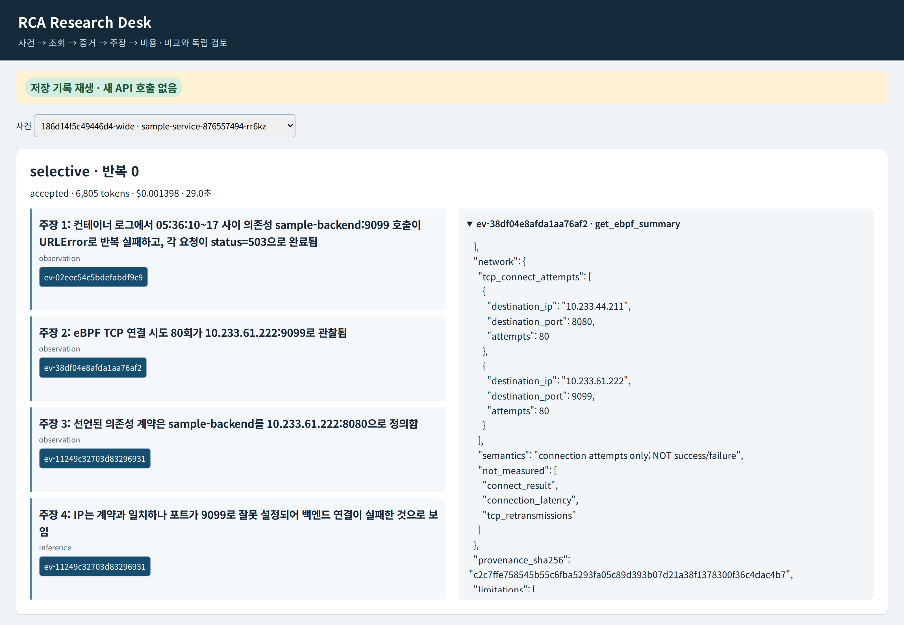

# 실제 기록 재생 화면 캡처

PPT에는 **[02-analysis-evidence-ppt.png](02-analysis-evidence-ppt.png)**를 사용한다. 실제 저장 기록을 Chromium에서 렌더링한 PNG이며, 분석 주장과 인용된 eBPF 증거를 크게 볼 수 있도록 기존 UI 요소의 배치와 표시 범위만 조정했다. 답변·증거 문구나 수치를 다시 작성하지 않았다.

캡션:

> 장애 사건별 조사 과정과 분석 결과를 비교하고, 결론에 인용된 실제 증거를 확인할 수 있다.

화면 상단에는 **저장 기록 재생 · 새 API 호출 없음**이라고 표시했다. 이 발표용 확대 화면은 선택 방식 하나의 주장과 증거에 집중한다. 방식별 좌우 비교는 [01-comparison-original.png](01-comparison-original.png)를 사용한다.

- 사건: `186d14f5c49446d4-wide`
- 왼쪽 비교 run: `604fd0107e743ecfc792` (batch)
- 선택 run: `61001361d065868158f7` (selective)
- 펼친 증거: `ev-38df04e8afda1aa76af2`
- 80회는 TCP 연결 **시도** 횟수다. eBPF 성공/실패 판정이 아니다.
- `accepted`는 출력 계약 통과이며 독립 진단 품질 채점 결과가 아니다. 화면의 반복 번호 0은 첫 실행의 0부터 시작하는 인덱스다.

01은 기존 비교 레이아웃의 전체 화면이다. 한글 글꼴과 재생 표시만 적용했다. 02는 동일 페이지에서 주장 1–4와 실제 증거 패널을 두 열로 재배치하고 증거 내부를 network 필드로 스크롤한 발표용 캡처다. 이미지 생성 모델로 만든 목업이 아니다. 고정된 HTML/실험 데이터는 변경하지 않았다.

외부 HTTP(S) 요청은 브라우저에서 차단했고 발생 건수는 0이다. 실제 API 실행 버튼이 비활성화된 것을 검사했다. 브라우저 오류도 0이다. 원본 hash와 캡처 방법은 [capture-metadata.json](capture-metadata.json)에 기록했다. 캡처 스크립트도 함께 제공한다. 재현하려면 Playwright 1.56.1/Chromium 141.0.7390.37, 임시 Noto Sans KR 글꼴 및 기존 재현 패키지의 viewer/index.html이 필요하다.
